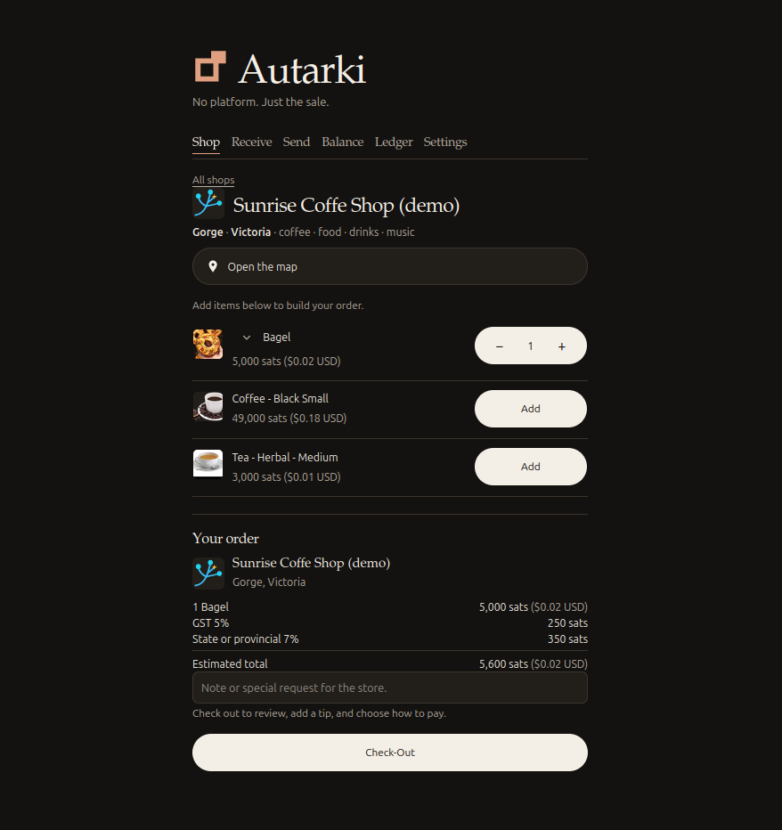
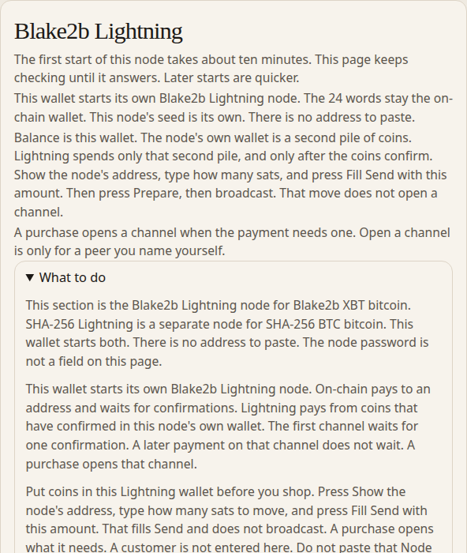
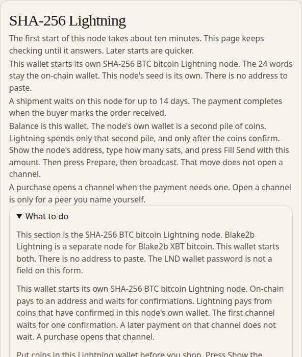
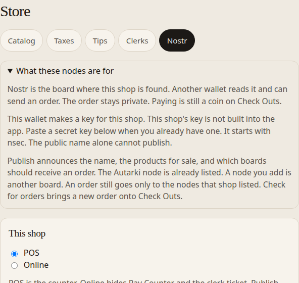

<p align="center">
  
</p>

# Autarki - Wallet / Nostr Shop

No platform. Just the sale.

Autarki is a wallet, a shop, a classifieds board, and a way to hire a listed rig. Someone who has never heard of Bitcoin can open the page and look through the shops before a wallet exists. Looking through the shops does not need one. Classifieds are on the same page after Enable Classifieds.

This wallet starts its own Lightning node for Blake2b XBT bitcoin and its own Lightning node for SHA-256 BTC bitcoin. You do not install a separate Lightning app. A purchase opens a channel when the payment needs one. Nostr is how a shop is found, and how an order arrives, without a website of your own. The stall, each product, and each classified are public notes. Anyone can read them. The order is a private note. The node that carries it cannot read it.

Run it on:

- **StartOS**, on an AMD or Intel server (`autarki_x86_64.s9pk`) or a Raspberry Pi (`autarki_aarch64.s9pk`). The AMD or Intel package starts the built-in Lightning nodes. The Pi package does not. The reason is under [Raspberry Pi](#raspberry-pi). The package inside the files on release 0.1.0 is 0.1.0:26. The release tag stays 0.1.0. The pictures below are the current wallet.
- **Umbrel**, including Umbrel Home and a Raspberry Pi, on umbrelOS 1.x and on umbrelOS 2.0. Install from the RouteHash community store. This page has no umbrelOS file. On a Raspberry Pi, Lightning stays off. The reason is under [Raspberry Pi](#raspberry-pi).
- **Ubuntu server** with Docker (`autarki_ubuntu_amd64.tar`). That file is the AMD or Intel build, and it includes Lightning. The steps are on the [Ubuntu page](https://github.com/RouteHash-com/autarki/blob/main/ubuntu/README.md).
- **Docker images** `autarki_0.1.0_amd64.tar` and `autarki_0.1.0_arm64.tar`. Those images are from this build. They are not an umbrelOS install. The arm64 image is the Raspberry Pi build, and Lightning stays off on it.

The words, the shop book, and the sale stay on that server.

## Raspberry Pi

The Raspberry Pi package stays. The wallet, the shop, Nostr, and on-chain payment run on it.

Lightning stays off on that package. The Lightning programs in this beta are built for AMD and Intel only. The Pi package does not contain those programs, so it cannot start the built-in Lightning nodes. A Lightning payment, a shipment, and Mine pay through Lightning. Do those from the AMD or Intel package until a Pi build of the Lightning programs is included.

This version starts Lightning for you on an AMD or Intel machine. It does not ask you to type in a Lightning node of your own.

<p align="center">
  
</p>

<p align="center">
  
</p>

<p align="center">
  
</p>

<p align="center">
  
</p>

## What you get

One page: Shop, Receive, Send, Balance, Ledger, Store, Mining, Classifieds, and Settings. Settings is the gear on the first row. Classifieds stays hidden until you turn on Enable Classifieds under Settings. The Mining tab is on this page once this wallet is open. Paste the API token on Mining, or under Settings. Before that account is saved, Balance says to hire a rig, and the rewards come back to this wallet. After it is saved, Balance lists Open Mining Invoices.

**Look before a wallet exists.** The shop opens first. Search on Shop is a shop, a product, or a place. Read the products. A first purchase does not have to be a coin. Classifieds open on this page after Enable Classifieds.

**Prices.** A price is whole satoshis. A US dollar or Canadian dollar figure sits beside it as a hint, so the number is familiar. The amount due stays in sats. Each wallet chooses US dollars or Canadian dollars under Settings, then Coin Nodes, and again under Store, then Taxes. Switching the hint changes the dollar figure. It does not change the sats.

**Wallet.** Receive, send, and a balance for Blake2b XBT bitcoin, for SHA-256 BTC bitcoin, and for XBTC. XBTC is the third chain. A shop checkout asks for XBT, BTC, or XBTC. Pay with XBTC is there when the XBTC node on this wallet is active and the shop published an XBTC account. Pay with XBT and Pay with BTC stay. A shipment does not offer XBTC. Blake2b XBT bitcoin and SHA-256 BTC bitcoin each have a Lightning node this wallet starts. XBTC does not. Blake2b XBT bitcoin and SHA-256 BTC bitcoin use Autarki's servers until you connect your own node under Settings, then Coin Nodes. XBTC uses Autarki's public node until you connect your own. The StartOS package and the Umbrel package do not include that node. A silent-payment code for an address of yours is used only after that node is connected. Until then the page gives a normal address. A code you type on Send uses your own node.

**Shop.** A merchant builds the order on the page. Use it as an in-person point of sale, or set the shop to Online and take the order over Nostr. An online order can be shipped. The coins wait with the parcel until the buyer marks it received.

**Pay Counter.** On a shop at the counter, Pay Counter is where the clerk records the sale: cash, a debit card, a credit card, a coupon, store credit, bitcoin, or a mix. The page does not charge the card. The clerk records that. The clerk ticket shows the last four characters of the order. Set the shop to Online when the sale is not at the counter. Online hides Pay Counter and that ticket. Publish announces the choice. Until you publish, customers still see the counter.

**Classifieds.** Goods, Services, Jobs, Rentals, Giveaways, and Personals. The detail is below.

**Mining.** The Mining tab is on this page once this wallet is open. Hire a listed Blake2b rig with Blake2b XBT bitcoin, or a listed SHA-256 rig with SHA-256 BTC bitcoin. The detail is below.

**Nostr.** This is what keeps the sale off a platform. A shop is found, and an order arrives, without a website of your own. The stall, each product, and each classified are public notes. Anyone can read those notes. The order is a private note. The node that carries it cannot read it. A shop that runs its own Nostr node keeps those public notes on that machine. Autarki's node is the shared board until then. This wallet does not send the shop book to that shared node. Autarki's node does not charge to post.

The first screen creates the wallet. Write the 24 words on paper before you leave that screen. A password for this copy is optional. Leave both password fields blank and the 24 words are stored unencrypted on this device. A backup of this service is then the seed. Restore the 24 words is on that same screen. It shows the first XBT address and does not show the words again. A shorter phrase uses Import a BIP39 phrase. A native SegWit phrase can be imported on that same screen. After that import you can set a password, or leave the copy unlocked.

Settings, then Nostr Node, then A copy of the shop, saves the catalog, the orders, the coin journal, and the classifieds to a file on this computer or a drive. Bring a copy back replaces that book. The file leaves out the 24 words, the wallet file, a secret key, a macaroon, and a node password. The Lightning channel stays on the Lightning node. The copy also keeps the profile, the contact list, the mute list, the relay list, the Discord link, vouches, and shipment receipts this wallet has already published. Publish this shop, or publish a classified, sends those notes to the current node. The stall, each product, and each classified are already notes on the Nostr node. Anyone can read those notes. This wallet does not send the shop book to that shared node. A shop that runs its own Nostr node keeps those public notes on that machine. Autarki's node is the shared board until then.

Nostr is how a shop is found, and how an order reaches that shop, without a website of your own. Publish announces the shop name, the products for sale, and which nodes should receive an order. Check for orders brings a new order onto Check Outs. The amount due stays in sats. A counter sale can be a coin, Lightning, or what the clerk recorded: cash, a debit card, a credit card, a coupon, store credit, bitcoin, or a mix. The order itself does not move the money. When the clerk marks a counter sale paid, the customer's page shows that order under Ledger, then Receipts.

The three chains are Blake2b XBT bitcoin, SHA-256 BTC bitcoin, and XBTC. XBTC is the third chain. Blake2b XBT bitcoin and SHA-256 BTC bitcoin use Autarki's servers until you connect your own node under Settings, then Coin Nodes. A silent-payment code for an address of yours is used only after that node is connected. Until then the page gives a normal address. Paying a shop order uses the stall's silent-payment code from that order. A code you type on Send uses your own node. XBTC uses Autarki's public node until you connect your own. Where this copy includes Autarki's XBTC node, that node is used until you connect your own. The StartOS package and the Umbrel package do not include that node. Nostr uses Autarki's public node until you add another. This wallet starts its own Blake2b XBT bitcoin Lightning node and its own SHA-256 BTC bitcoin Lightning node. The 24 words stay the on-chain wallet. Each Lightning seed is its own. The longer notes on those cards stay closed until you open them. A purchase opens a channel when the payment needs one. Open a channel is the form for a Lightning node whose public name you already have. A purchase does not use that form.

On Receive, Send, Balance, and the till, the SHA-256 BTC bitcoin chip says BTC. The Blake2b XBT bitcoin chip says XBT. Remove this node, under Settings, then Coin Nodes, hides that chain on those screens, on checkout, and on Check Outs. Use this node brings it back. The choice stays in this browser. A saved connection stays on this computer. A Raspberry Pi package does not include the Lightning programs, because those programs in this beta are built for AMD and Intel only, and on that package the nodes stay off. The wallet, the shop, Nostr, and on-chain payment still run there. The reason is under [Raspberry Pi](#raspberry-pi).

On Umbrel you can run Knots for Blake2b XBT bitcoin, Knots for XBTC, or Bitcoin Core for SHA-256 BTC bitcoin. XBT Knots and Bitcoin Core do not run on the same computer. XBTC Knots can run on the same computer as XBT Knots. This package does not treat Bitcoin Core as the Blake2b XBT bitcoin node. Blake2b XBT bitcoin is Bitcoin Knots. SHA-256 BTC bitcoin is Bitcoin Core. A giveaway, a personal, or a job you are hiring for can be posted with no coin node. A store catalog can be saved and announced too. Goods, a service, a rental, or a job offered for a price needs the Blake2b XBT bitcoin node or the SHA-256 BTC bitcoin node. One is enough. That ad can carry a payment code for each connected node. Buyers pay that shop on-chain after a coin node is connected and you publish the shop again.

## Ship an online order

You can buy from someone you have never met, and they can ship to you, without a platform holding the money. You pay with Lightning. The coins sit on the seller's node. The seller sends the parcel knowing that money is there. You mark it received when it is in your hands, and the seller is paid.

An online shop asks Ship or Pick up before the order is sent. There is no default. Pick up pays the shop directly, the same as a counter sale. A classified seller can offer Ship with no store. On that board the word is seller. On a shop order the word is shop. The hold is the same. On-chain is not offered for a shipment.

Before the seller marks it shipped, Cancel is still open. Nothing has been handed to the shipper. The seller is told, the order closes, and the coins go back to you.

Cancel is closed once it has shipped. You see Shipped, the carrier, the tracking number, and a link to the shipper's tracking page. Mark received pays the seller. Not received stops both automatic moves. The coins stay held until you mark it received, or until the Lightning window ends and the coins come back to you.

The seller names how many days they have to ship, up to four, and whether the hold is 14 days at home or 28 days overseas. The clock starts when the payment is accepted. If they have not marked it shipped, with a carrier and a tracking number, by that ship-by day, the coins go back to you. If they did ship it and you do nothing, the seller is paid when the hold ends.

Check the carrier asks the shipper's tracking service and saves that scan as words on the order. Canada Post, UPS, FedEx, and DHL are the names it can look up. The scan does not move the coins. The seller's wallet and Lightning node stay on through the window. If this wallet never acts, the Lightning window still sends the coins back to you.

Each open order shows Ordered by and a short public name. On a customer wallet, Balance keeps See open orders and opens Shop. On the shop's wallet, an order that is still open opens Ledger, then Check Outs.

The stall card shows the shop's short public name, the day the stall note was signed, and the payment codes. It shows how many shipments this wallet has marked received, and how many are still unfinished. After a completed shipment, the stall can show how many receipts both keys signed.

Pick up on a classified offers Pay with XBT, Pay with BTC, and Pay with XBTC. Lightning sits under XBT and under BTC. Pay with XBTC is there when the XBTC node on this wallet is active and the ad published an XBTC account. It has no Lightning button. Ship offers XBT Lightning and BTC Lightning. On-chain is not offered for a shipment, and a shipment does not offer XBTC. When this wallet is the seller, that Lightning payment request comes back on the click. The customer ledger names the order, the store, and the store owner. The coin download includes the product, the store, the date, and the charges on that order.

## Classifieds

Classifieds stays hidden until you turn on Enable Classifieds under Settings. A new wallet leaves it off. Turning it off hides the tab. A draft stays on this computer.

The categories are Goods, Services, Jobs, Rentals, Giveaways, and Personals. Goods, a service, and a rental ask for a price. A job asks Offer or Hire. A giveaway and a personal do not ask for a price. An ad can carry up to four image addresses. A map link is an https address from OpenStreetMap, Google Maps, or Apple Maps. What is a map link? tells you to copy that address and paste it into Map. Use my location copies the shop's saved country, province or state, city, neighbourhood, and map link. It does not open that explanation.

On Shop, search is a shop, a product, or a place. On Classifieds, search sits to the left of the keyword. Set location on that board searches a city. Use my location there asks the browser, then looks up the city. The position is not saved. Post and Check for orders are icons on the same row as Show Ignored and View blocked. My Ads, beside Post, shows the ads saved on this computer. Opening Post hides the ads. Edit is on your own classified card. Cancel on the ad form leaves it without saving. Save and Publish return to the board when they succeed. One buyer and one listing stay one unpaid order. With the store off, a classified sale still shows on Check Outs until it is paid, and on Sales after that. A classified ad and a store listing are saved to the same Nostr account on the relay(s); they use the same key. A Discord username can be shown beside the shop. The shop and the classified stay public. The link is not required to buy or sell. Publishing an ad does not require a store listing. Place notes sit on the Country row. Each connected coin node gets a silent-payment code, so a buyer can pay that chain. The buyer pay card uses the same code picture as a shop order, with the chain name in the center.

Classifieds use their own node list. Kind 30402 is the classified. The stall and the products stay kinds 30017 and 30018. The nodes that receive an order are kind 10050. The private order is kind 1059. The order is a private note. The node that carries it cannot read it. If Shop or Classifieds comes back empty, check the node. If it allows every kind, leave it that way. If it only allows some kinds, allow 30402, 30017, 30018, 10050, and 1059. A whitelist that should check the receipt count also allows 38383 and 38384. A whitelist that should show the Discord link also allows 10011.

A price line reads whole satoshis, then a US dollar or Canadian dollar figure as a hint, then now at market price. The amount due stays in sats. The word price opens the Neoxa market for BTCB2 and USDC:

https://neoxa.exchange/trade/BTCB2_USDC

A name on a post or an order is the display name that person published, or their name when they published no display name. A click copies the public name. A missing profile leaves the short public name. That name is what they wrote. It is not a checked website name. Kind 0 is a profile. A whitelist that should show a name also allows kind 0.

## Hire a listed rig

Open a RouteHash account at https://routehash.com. Paste that account's API token on Mining, or under Settings. That account shows the Mine cards. Hire a listed Blake2b rig with Blake2b XBT bitcoin, or a listed SHA-256 rig with SHA-256 BTC bitcoin.

Mine writes a Lightning invoice for accepted shares and waits until you click Pay. Paying it starts that rig only. The button says Pay to start on the first invoice, and Pay to keep on a later invoice for a rig that is already hashing. Add Hash puts another rig on the same card. Blake2b is one card. SHA-256 is the other card.

Hours from balance uses the confirmed balance on that account for the rig's minimum time. The first click quotes the hire. The second click spends it. Nothing is spent until you click Mine or confirm those hours.

The card shows the work still paid for. The countdown starts when the rig is hashing. Before payment the card shows the time you bought. The payout address is on the card while a hire is running or waiting for payment. You can remove a hire that is still waiting, or stop one that is hashing.

Balance lists Open Shop Orders. Before the RouteHash account is saved, it says to hire a rig, and the rewards come back to this wallet. Once that account is saved, it lists Open Mining Invoices for a hire that is running or waiting for payment.

## Install on Umbrel

This page does not give you an umbrelOS file. umbrelOS 1.x and umbrelOS 2.0 use the same listing. It is version 0.1.14. A wallet from 0.1.13 stays. If the store still shows 0.1.13, remove this community store and add the same address again.

1. In Umbrel, open Settings, then App stores, then Add a community app store.
2. Paste this address:

```
https://github.com/RouteHash-com/umbrel-store
```

3. Install **Autarki - Wallet / Nostr Shop**.

That store is the RouteHash community store. It is not the official Umbrel App Store. If the store is already added, or an install fails after you update to umbrelOS 2.0, remove this community store and add the same address again. Umbrel keeps the copy it already downloaded.

Umbrel builds the app on the machine. A PC, Umbrel Home, and Umbrel Pro use the amd64 program. A Raspberry Pi uses the arm64 program.

To check those programs yourself, open the `routehash-autarki` folder in the store and run:

```
sha256sum -c SHA256SUMS
```

| Program | SHA-256 |
| --- | --- |
| `bin/autarki-amd64` | `72adccdd831edd981bb4488ff963536d308cfc4bd987e77c1751b62406be828b` |
| `bin/autarki-arm64` | `ebb05ef96f081aeabc7c2f585722b394a37a7fe86d10790df143f281d3ca7602` |

## Which file to download

StartOS uses a file from release 0.1.0. Umbrel does not. `x86_64` is the 64-bit build for an AMD PC and for an Intel PC. `aarch64` is the build for a Raspberry Pi. StartOS does not use a separate file named amd64.

| Install on | Machine | File |
| --- | --- | --- |
| StartOS | AMD or Intel, 64-bit | `autarki_x86_64.s9pk` |
| StartOS | Raspberry Pi | `autarki_aarch64.s9pk` |

Download the StartOS package:

https://github.com/RouteHash-com/autarki/releases/tag/0.1.0

The same release also attaches `autarki_0.1.0_amd64.tar` and `autarki_0.1.0_arm64.tar`. Those are Docker images from this build. They are not an umbrelOS 2.0 install, and the community store does not use them. An Ubuntu server uses `autarki_ubuntu_amd64.tar`. The steps are on the Ubuntu page. Sizes and checksums for every file on the release:

| File | Bytes | SHA-256 |
| --- | ---: | --- |
| `autarki_x86_64.s9pk` | 407980502 | `0324a6fd7d63d16492c774d007fff34a1e565a1f802a9868dd553ab32ce331bd` |
| `autarki_aarch64.s9pk` | 47057369 | `e73b8cd855ef4b147a55e549dd14bb7e153ba68f505c0b2a3f712e6283943c28` |
| `autarki_0.1.0_amd64.tar` | 1477122048 | `1a2c8a8b7b9a0fb80ae8fb16f79f4d5e4a01c859c75aad46c15250bbe13487d6` |
| `autarki_0.1.0_arm64.tar` | 178084352 | `2aa974394fe3f0b0dcb58acedf19b75dfec05954b4eaf573010cccebed27e1f1` |
| `autarki_ubuntu_amd64.tar` | 1477122048 | `db5db826c8fe49ab9aa7d349a24771ffc09aae09a7f6009a20b12d5645877d3b` |

The package version inside each StartOS file is 0.1.0:26. Sideloading it replaces 0.1.0:25, and the wallet stays.

## Check the download

Put `SHA256SUMS` from the release in the same folder as the file you downloaded. Then run:

```
sha256sum -c SHA256SUMS --ignore-missing
```

The line for your file ends in `OK` when the download matches. A partial download does not.

## Install on Ubuntu

An Ubuntu server with Docker, and without StartOS or Umbrel, uses `autarki_ubuntu_amd64.tar` from the same release. The steps and the compose file are on the Ubuntu page:

https://github.com/RouteHash-com/autarki/blob/main/ubuntu/README.md

## Install on StartOS

1. Download the package that matches the server. An AMD or Intel server uses `autarki_x86_64.s9pk`. A Raspberry Pi uses `autarki_aarch64.s9pk`. Check it with the command above.
2. In StartOS, sideload that file and install Autarki. Install does not ask for Bitcoin Knots or Bitcoin Core.
3. Open Autarki.
4. Create the wallet. Write the 24 words on paper before you leave the screen.

The shop opens first, until the wallet exists. After that, the page opens on Receive.

## First sale

Open Shop. Add the items. Read the tax lines and the estimated total. Write a note if the guest asked for one.

At the counter, press Check-Out. For an online order, publish the shop under Store, then Nostr, and press Check for orders when a customer has sent one.

The guide on the server is under Settings, then Read the guide.
