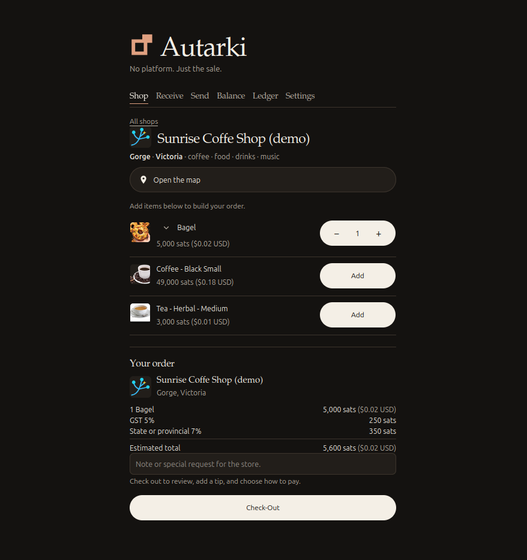

<p align="center">
  
</p>

# Autarki - Wallet / Nostr Shop

No platform. Just the sale.

Autarki is the wallet and the Nostr shop. It runs on an AMD or Intel server and on a Raspberry Pi. On StartOS, a Raspberry Pi uses `autarki_aarch64.s9pk`. On Umbrel, including Umbrel Home and a Raspberry Pi, install from the RouteHash community store. That listing installs on umbrelOS 1.x and on umbrelOS 2.0. This page has no umbrelOS file to download. A merchant builds the order on the page. Use it as an in-person point of sale, or set the shop to Online and take the order over Nostr. The same page hires a listed rig, posts a classified, and an online order can be shipped. The words, the shop book, and the sale stay on that server.

Ordinary XBT and SHA-256d use Autarki's servers until you connect your own node under Settings, then Coin Nodes. XBTC uses Autarki's public node until you connect your own. The StartOS package and the Umbrel package do not include that node. A customer can pay at the counter or send the order from their own wallet.

<p align="center">
  
</p>

## What you get

One page: Shop, Receive, Send, Balance, Ledger, Store, Mining, Classifieds, and Settings. Settings is the gear on the first row. Classifieds stays hidden until you turn on Enable Classifieds under Settings. Mining stays hidden until you save a RouteHash account under Settings. Open Mining Invoices on Balance follows that same account.

The first screen creates the wallet. Write the 24 words on paper before you leave that screen. A password for this copy is optional. Leave it blank and the 24 words stay in the clear, so a backup of this server is then the seed. A native SegWit phrase can be imported on that same screen. After that import you can set a password, or leave the copy unlocked.

The shop opens as a point of sale. A guest at the counter uses Pay Counter, and the clerk ticket shows the last four characters of the order. Set the shop to Online when the sale is not at the counter. Online hides Pay Counter and that ticket. Publish announces the choice. Until you publish, customers still see the counter.

Nostr is how a shop is found, and how an order reaches that shop, without a website of your own. Publish announces the shop name, the products for sale, and which nodes should receive an order. Check for orders brings a new order onto Check Outs. Paying is still a coin, cash, a card, or Lightning. The order itself does not move the money. When the clerk marks a counter sale paid, the customer's page shows that order under Ledger, then Receipts.

The three chains are ordinary XBT, SHA-256d, and XBTC. XBTC is the third chain. Ordinary XBT and SHA-256d use Autarki's servers until you connect your own node under Settings, then Coin Nodes. A silent-payment code for an address of yours is used only after that node is connected. Until then the page gives a normal address. Paying a shop order uses the stall's silent-payment code from that order. A code you type on Send uses your own node. XBTC uses Autarki's public node until you connect your own. Where this copy includes Autarki's XBTC node, that node is used until you connect your own. The StartOS package and the Umbrel package do not include that node. Nostr uses Autarki's public node until you add another. Blake2b Lightning and SHA-256 Lightning are your own nodes. The seed stays in this wallet. The longer notes on those cards stay closed until you open them. The address, the certificate, and the channel amount stay on the page.

On Receive, Send, Balance, and the till, the ordinary Bitcoin chip says BTC. Under Settings, then SHA-256 Lightning, the save button says Save BTC Lightning. Remove this node, under Settings, then Coin Nodes, hides that chain on those screens, on checkout, and on Check Outs. Use this node brings it back. The choice stays in this browser. A saved connection stays on this computer.

On Umbrel you can run Knots for XBT, Knots for XBTC, or Bitcoin Core for SHA-256. XBT Knots and Bitcoin Core do not run on the same computer. XBTC Knots can run on the same computer as XBT Knots. This package does not treat Bitcoin Core as the XBT node. Blake2b Lightning is Lightning Fork, which PaulsCode made for XBT Knots. SHA-256 Lightning is LND, for Bitcoin Core. A giveaway, a personal, or a job you are hiring for can be posted with no coin node. A store catalog can be saved and announced too. Goods, a service, a rental, or a job offered for a price needs the XBT node or the Bitcoin node. One is enough. That ad can carry a payment code for each connected node. Buyers pay that shop on-chain after a coin node is connected and you publish the shop again.

## Ship an online order

An online shop asks Ship or Pick up before the order is sent. There is no default. Pick up pays the shop directly, the same as a counter sale. A shipment pays with Lightning. The shop marks it shipped. The customer marks it received. The shop's node holds the coins until the customer marks the order received. Tracking is a note on the order. If the customer does not mark it received, the hold ends and the coins return to the customer. The shop's node has to stay on for that window.

Each open order shows Ordered by and a short public name. On a customer wallet, Balance keeps See open orders and opens Shop. On the shop's wallet, an order that is still open opens Ledger, then Check Outs.

The stall card shows the shop's short public name, the day the stall note was signed, and the payment codes. It shows how many shipments this wallet has marked received, and how many are still unfinished.

## Classifieds

Classifieds stays hidden until you turn on Enable Classifieds under Settings. A new wallet leaves it off. Turning it off hides the tab. A draft stays on this computer.

The categories are Goods, Services, Jobs, Rentals, Giveaways, and Personals. Goods, a service, and a rental ask for a price. A job asks Offer or Hire. A giveaway and a personal do not ask for a price. An ad can carry up to four image addresses. A map link is an https address from OpenStreetMap, Google Maps, or Apple Maps. What is a map link? tells you to copy that address and paste it into Map. Use my location copies the shop's saved country, province or state, city, neighbourhood, and map link. It does not open that explanation.

Search sits to the left of the keyword. Post and Check for orders are icons on the same row as Show Ignored and View blocked. Opening Post hides the ads. A classified ad and a store listing are saved to the same Nostr account on the relay(s); they use the same key. Publishing an ad does not require a store listing. Place notes sit on the Country row. Each connected coin node gets a silent-payment code, so a buyer can pay that chain. The buyer pay card uses the same code picture as a shop order, with the chain name in the center.

Classifieds use their own node list. Kind 30402 is the classified. The stall and the products stay kinds 30017 and 30018. The nodes that receive an order are kind 10050. The private order is kind 1059. The order is a private note. The node that carries it cannot read it. If Shop or Classifieds comes back empty, check the node. If it allows every kind, leave it that way. If it only allows some kinds, allow 30402, 30017, 30018, 10050, and 1059.

A price line reads Price in sats, then an approximate dollar amount, then now at market price. The word price opens the Neoxa market for BTCB2 and USDC:

https://neoxa.exchange/trade/BTCB2_USDC

A name on a post or an order is the display name that person published, or their name when they published no display name. A click copies the public name. A missing profile leaves the short public name. That name is what they wrote. It is not a checked website name. Kind 0 is a profile. A whitelist that should show a name also allows kind 0.

## Hire a listed rig

Save a RouteHash account under Settings. The account is the one on https://routehash.com. That account unlocks Mining. Hire a listed Blake2b rig with XBT, or a listed SHA-256 rig with BTC.

Mine writes a Lightning invoice for accepted shares and waits until you click Pay. Paying it starts that rig only. The button says Pay to start on the first invoice, and Pay to keep on a later invoice for a rig that is already hashing. Add Hash puts another rig on the same card. Blake2b is one card. SHA-256 is the other card.

Hours from balance uses the confirmed balance on that account for the rig's minimum time. The first click quotes the hire. The second click spends it. Nothing is spent until you click Mine or confirm those hours.

The card shows the work still paid for. The countdown starts when the rig is hashing. Before payment the card shows the time you bought. The payout address is on the card while a hire is running or waiting for payment. You can remove a hire that is still waiting, or stop one that is hashing.

Balance lists Open Shop Orders. Once the RouteHash account is saved, it also lists Open Mining Invoices for a hire that is running or waiting for payment.

## Install on Umbrel

This page does not give you an umbrelOS file. umbrelOS 1.x and umbrelOS 2.0 use the same listing. It is version 0.1.10. A wallet from 0.1.9 stays. If the store still shows 0.1.9, remove this community store and add the same address again.

1. In Umbrel, open Settings, then App stores, then Add a community app store.
2. Paste this address:

```
https://github.com/RouteHash-com/umbrel-store
```

3. Install **Autarki - Wallet / Nostr Shop**.

That store is the RouteHash community store. It is not the official Umbrel App Store. If the store is already added, or an install fails after you update to umbrelOS 2.0, remove this community store and add the same address again. Umbrel keeps the copy it already downloaded.

Umbrel builds the app on the machine. A PC, Umbrel Home, and Umbrel Pro use the amd64 program. A Raspberry Pi uses the arm64 program.

To check those programs yourself, open the `routehash-autarki` folder in the store and run:

```
sha256sum -c SHA256SUMS
```

| Program | SHA-256 |
| --- | --- |
| `bin/autarki-amd64` | `c9e83a04d188d83fb409d5d99aa54814addb6a6fe4c0425c46c2b8f58b35a72c` |
| `bin/autarki-arm64` | `a262bd50f810e0d2b999cf58c221210880cee6f7a867f98cf9ae4550bf626066` |

## Which file to download

StartOS uses a file from release 0.1.0. Umbrel does not. `x86_64` is the 64-bit build for an AMD PC and for an Intel PC. `aarch64` is the build for a Raspberry Pi. StartOS does not use a separate file named amd64.

| Install on | Machine | File |
| --- | --- | --- |
| StartOS | AMD or Intel, 64-bit | `autarki_x86_64.s9pk` |
| StartOS | Raspberry Pi | `autarki_aarch64.s9pk` |

Download the StartOS package:

https://github.com/RouteHash-com/autarki/releases/tag/0.1.0

The same release also attaches `autarki_0.1.0_amd64.tar` and `autarki_0.1.0_arm64.tar`. Those are Docker images from this build. They are not an umbrelOS 2.0 install, and the community store does not use them. Sizes and checksums for every file on the release:

| File | Bytes | SHA-256 |
| --- | ---: | --- |
| `autarki_x86_64.s9pk` | 30667049 | `e2db0bfeee02bb73be67904486f6f8ac34e053157e44297e403ca411eae8fb84` |
| `autarki_aarch64.s9pk` | 29237548 | `0fd0520711f40073371d16ffcabd290408ecc0d922b1d6b5f9c4c7b2dc0ecc86` |
| `autarki_0.1.0_amd64.tar` | 110722048 | `22f2df9685a87ad9b52558b91899db78380ae2fc5eeb4cc3bb6cca36f33f0c15` |
| `autarki_0.1.0_arm64.tar` | 131629568 | `79e362c8fef0aed5c8799a9903ee0fb593c0109ed241419e270d28ffc038fdd1` |

The package version inside each StartOS file is 0.1.0:8. Sideloading it replaces 0.1.0:7, and the wallet stays. Edit on a catalog product opens the form on that product and brings it into view.

## Check the download

Put `SHA256SUMS` from the release in the same folder as the file you downloaded. Then run:

```
sha256sum -c SHA256SUMS --ignore-missing
```

The line for your file ends in `OK` when the download matches. A partial download does not.

## Install on StartOS

1. Download the package that matches the server. An AMD or Intel server uses `autarki_x86_64.s9pk`. A Raspberry Pi uses `autarki_aarch64.s9pk`. Check it with the command above.
2. In StartOS, sideload that file and install Autarki. Install does not ask for Bitcoin Knots or Bitcoin Core.
3. Open Autarki.
4. Create the wallet. Write the 24 words on paper before you leave the screen.

The shop opens first, until the wallet exists. After that, the page opens on Receive.

## First sale

Open Shop. Add the items. Read the tax lines and the estimated total. Write a note if the guest asked for one.

At the counter, press Check-Out. For an online order, publish the shop under Store, then Nostr, and press Check for orders when a customer has sent one.

The guide on the server is under Settings, then Read the guide.
